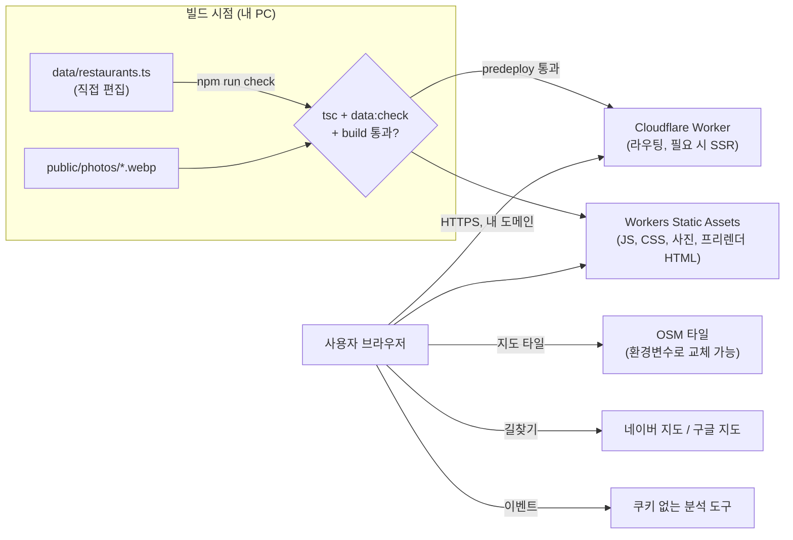

# Hyochang Eats — 구현 계획과 설계 (v2)

- 기준 문서: [PRD](https://claude.ai/artifact/DD8Sp1T6dWADbNPdZqPQYB) (2026-11-14 기준)
- 작성일: 2026-11-14 · v2: 설계 검토([plan-review.md](plan-review.md), 23건) 반영 · v3(2026-11-15): 서비스 중심을 역에서 숙소로 변경, 반경 600m
- 상태: 검토 반영 완료, 열린 질문 Q2·Q3 결정 대기

## 1. 요약

**숙소 Hyochang Park Stay(서울 용산구 원효로1가 23-70, 백범로81길 7) 반경 600m**(걸어서 약 8분, 용문시장 포함)의 외국인 친화 맛집 30곳을 지도로 보여주는 영어 기본·한국어 지원 모바일 웹앱을 5주 안에 정식 출시한다. 숙소 이용 손님에게 공유하는 것이 목적이다. 효창공원앞역(숙소에서 약 310m)은 지도에 길잡이로만 표시한다.
서버·DB 없이 **정적 데이터 + Next.js(App Router) on vinext + Cloudflare Workers** 로 만든다.
**가장 큰 작업은 개발이 아니라 맛집 30곳 직접 검증·촬영·이중언어 작성(약 60시간)** 이므로, 일정은 "데이터 트랙"과 "개발 트랙"을 나란히 두고 데이터를 4주차 말까지 끝낸다.

## 2. 현재 상태 (1주차 진행분)

| 항목 | 상태 | 위치 |
| --- | --- | --- |
| vinext + Cloudflare 프로젝트 생성 | 완료 | `vite.config.ts`, `cloudflare.config.ts` |
| `/en`, `/ko` 라우트, `/` → `/en` 리다이렉트 | 완료 | `app/[lang]/`, `next.config.ts` |
| 지도(Leaflet + OSM 타일), 숙소 이름표 핀, 역·용문시장 표시, 숙소 600m 범위 원 | 완료 | `components/MapView.tsx`, `lib/area.ts` |
| 카테고리(한식·분식·고깃집·치킨·중식·국수·카페·술집)·태그 필터, 목록, 상세 카드, 길찾기 링크 | 완료 | `components/Explorer.tsx` |
| 내 주변(위치) 정렬, 숙소 기준 거리 정렬 | 완료 | `components/Explorer.tsx` |
| 맛집 데이터 | **0곳** (샘플 삭제, 빈 목록이면 "곧 올라와요" 안내) | `data/restaurants.ts` |
| 맛집 조사 후보 496곳(숙소 600m 안 460곳, 용문시장 92곳), 외국인 인기 메뉴별 묶음 | 완료 | `docs/research-candidates.md` |
| 로컬 빌드, 타입 검사 | 통과 | — |
| Cloudflare 배포 | 완료: https://hyochang-eats.tklee3043.workers.dev | — |
| git | GitHub 공개 저장소 `tklee3043-rgb/hyochang-eats` | — |

## 3. 아키텍처

- **런타임 서버 로직 없음.** 맛집 데이터는 빌드 시 번들에 포함된다. 데이터 변경 = 재배포.
- **렌더링 방식 (검토 2번):** 지금 설정은 Cloudflare 배포 시 prerender 결과를 쓰지 않아 요청마다 Worker가 렌더링한다(배포 로그 경고, vinext README "server-renders all pages on each request"). 페이지가 사실상 정적(`/en`, `/ko`, 상세 30×2)이므로, 첫 배포에서 요청당 CPU 시간이 무료 플랜 한도에 가까우면 vinext의 `staticAssetsAdapter()`로 프리렌더 결과를 정적 자산으로 내보낸다(README: `prerender: true` + `cache: { cdn: staticAssetsAdapter() }`, 설정은 `vinext init --platform=cloudflare --cdn-cache=static-assets`).
- **무료 플랜 한도:** 일 요청 수와 요청당 CPU 시간 한도는 Cloudflare 공식 문서로 확인해 숫자와 링크를 여기에 적는다(1주차, 아직 미확인).
- **정적 파일 경로 (검토 12번):** `cloudflare.config.ts`의 `runWorkerFirst`가 `"/*"`라서 `public/photos/*`도 Worker를 먼저 거친다. 사진을 넣을 때 `"!/photos/*"`, `"!/favicon.ico"`, `"!/icons/*"`를 제외 목록에 추가한다.
- 사용자 위치는 브라우저 안에서만 쓰고 어디에도 보내지 않는다.

## 4. 주요 설계 결정

### D0. vinext 통과 기준과 시간 제한 (검토 3번)

1주차 첫 배포 후 **2일 안에** 아래를 모두 만족하지 못하면 Next.js로 전환한다.

1. `/en`, `/ko`가 휴대폰에서 HTTPS 주소로 열린다
2. 하이드레이션 오류·콘솔 오류가 없다
3. 요청당 CPU 시간이 무료 플랜 한도 안이다 (넘으면 먼저 `staticAssetsAdapter()` 시도)
4. `<title>` 중복 문제를 해결하거나 원인을 안다

**전환 방법:** 앱 코드는 `next/*` API만 쓰므로 `next` 설치 + `vite.config.ts`·`cloudflare.config.ts` 제거 + 배포처 변경 수준이다. 배포처 후보(Vercel 등)의 무료 플랜 상업적 이용 조건은 전환 시점에 확인한다.

### D1. 데이터 원본: TS 파일 직접 편집 (검토 8번, Q1 확정)

- 원본은 `data/restaurants.ts` 하나. 이미 타입이 있고, 입력자는 1명, 30곳이다.
- 구글 시트 → CSV 가져오기는 만들지 않는다. 협업자가 생기면 출시 후 다시 검토한다.
- PRD의 "`restaurants.json`" 표기는 이 결정에 맞게 고친다(§9).

### D2. 데이터 스키마 (추가·변경 필드)

| 필드 | 타입 | 이유 |
| --- | --- | --- |
| `links.naver` | string (URL) | 이름 검색은 다른 가게가 나올 수 있어서, 네이버 플레이스 고유 주소로 연결 |
| `links.google` | string (URL), 선택 | 없으면 좌표로 연결 |
| `address` | `{ en, ko }` | 택시 기사에게 보여주기, 간판 찾기 |
| `photos` | `{ src, alt: {en, ko} }[]` | 직접 촬영본만 |
| 태그 `spicy` → `mildOption` | 태그 이름 변경 (검토 15번) | 외국인에게 필요한 건 "안 매운 메뉴 있음". 매운 정도는 메뉴 설명에 적는다 |
| 태그 `halal` | **MVP 제외** (Q3 기본안) | 직접 검증하기 어렵고, 틀리면 종교 문제로 이어진다 |
| `hours` | 문자열 유지 | "지금 영업 중"은 출시 후 |

채식 태그가 붙은 가게의 상세 카드에는 "확인한 날짜 기준이에요. 주문할 때 다시 물어보세요" 문구를 함께 보여준다.

### D3. 데이터 검증 (`npm run data:check`)

Vitest 테스트 파일 하나(`data/restaurants.test.ts`)로 만들고, `npm run check`(= `tsc --noEmit` + `data:check` + `build`)를 `predeploy`에 연결한다.

1. `id` 중복 없음, 소문자·하이픈만
2. 모든 `{ en, ko }` 필드에 두 언어 모두 있음
3. 숙소(`STAY`)에서 직선거리 ≤ `SERVICE_RADIUS_M`(600m)
4. `category`, `tags` 값이 정해진 목록 안
5. `checkedAt`이 유효한 날짜. 180일이 지났으면 **경고**만 한다
6. `photos[].src` 파일이 `public/photos/`에 있고 파일 하나가 300KB 이하
7. **`RELEASE=1`일 때만** `sample: true`가 있으면 실패한다 (검토 7번: `vite build`와 배포는 항상 production 모드라 `NODE_ENV`로 막으면 1~4주차 배포가 모두 깨짐)

### D4. 라우팅과 페이지

| 경로 | 내용 | 단계 |
| --- | --- | --- |
| `/` | `/en`으로 307 리다이렉트 | 완료 |
| `/{lang}` | 지도 + 목록 (메인) | 완료 |
| `/{lang}/places/{id}` | 메인과 같은 `Explorer`를 해당 가게가 선택된 상태로 렌더링. 가게별 title·description·OG로 공유·검색 노출 | 3주차 |
| `/{lang}/privacy` | 개인정보처리방침 | 3주차 (초안) |
| `/sitemap.xml`, `/robots.txt` | 검색 노출 | 5주차 |

- 공유 링크는 **`/{lang}/places/{id}` 한 방식만** 만든다(검토 10번). `?place=` 쿼리 방식은 만들지 않는다.
- 가게를 고르면 주소를 `/{lang}/places/{id}`로 바꾼다(`router.replace`, 새로고침 없음). 닫으면 `/{lang}`.
- 언어 전환 버튼은 지금 보고 있는 경로를 유지한 채 언어만 바꾼다.
- 루트 레이아웃(`app/[lang]/layout.tsx`)에 `metadataBase`(도메인 확정 후)와 hreflang 절대 주소를 넣는다.
- `/fr` 같은 잘못된 언어와 `/favicon.ico` 요청이 깔끔하게 처리되는지 배포 후 확인한다. `public/favicon.ico`와 앱 아이콘을 추가하고, 필요하면 `app/not-found.tsx`를 만든다(검토 17번).

### D5. 다국어(i18n)

- 화면 문구는 `lib/i18n.ts`의 코드 사전을 유지한다(PRD의 `en.json`/`ko.json` 대신). 문구에 함수(거리 표기 등)가 필요하고 양이 적다.
- next-intl은 쓰지 않는다. App Router에서는 `[lang]` 세그먼트가 정석이다(vinext README의 i18n 라우팅 지원은 Pages Router 기준).
- 서버 컴포넌트 → 클라이언트 컴포넌트로 사전을 넘기지 않는다(함수는 직렬화 불가). 클라이언트는 `lang`만 받는다(구현됨).

### D6. 지도 타일 (검토 11번 반영으로 기본안 변경)

- **출시는 OSM 공식 타일을 유지한다.** OSM 타일 사용 정책이 막는 것은 대량 사용이고, 저트래픽 사이트는 출처 표기 등 조건을 지키면 쓸 수 있다(기억 기준 → 정책 원문을 확인해 링크를 여기에 붙인다). 출처 표기는 이미 있다.
- 타일 URL과 출처 문구를 환경변수(`NEXT_PUBLIC_TILE_URL`, `NEXT_PUBLIC_TILE_ATTRIBUTION`)로 빼서, 트래픽이 늘면 상용 타일(MapTiler, Stadia Maps 등)로 바로 바꿀 수 있게 한다.
- 상용 타일로 바꿀 때 확인할 것: 무료 플랜의 상업적 이용 조건, 브라우저에 노출되는 API 키의 도메인 제한.

### D7. 분석과 지표 측정 (검토 13번)

PRD 지표 중 "길찾기 클릭률"은 이벤트 추적이 필요하다.

- 쿠키 없는 분석 도구 1개(예: Umami Cloud, 무료 한도 확인 필요)로 페이지뷰 + 이벤트를 기록한다.
  - `place_open` (place id)
  - `directions_click` (provider: naver | google, place id)
  - `near_me` (result: granted | denied | out_of_area)
  - `js_error` (메시지 앞부분만, 개인정보 없이) — 검토 20번
- 분석 호출은 `lib/track.ts` 한 곳에 모은다.
- 분석 도구를 켜는 주(3주차)에 개인정보처리방침 초안을 같이 올린다(검토 6번).

| PRD 지표 | 측정 방법 | 계산식 | 시점 |
| --- | --- | --- | --- |
| 등록 맛집 30곳 이상 | `data:check` 출력 | `sample`이 아닌 항목 수 | 4주차 말 |
| 외국인 테스터 10명 | 테스트 기록 | 과제를 끝까지 한 인원 | 4주차 |
| "가보고 싶다" 70% 이상 | 테스트 후 설문 1문항(5점 척도, 4점 이상 = 예) | 예 ÷ 응답자 | 4주차 |
| 1분 안에 찾기 | 사용성 과제 3개를 스톱워치로 측정 (예: "숙소 근처에서 영어 메뉴 있는 분식집 찾기") | 과제별 중앙값 ≤ 60초 | 4주차 |
| 길찾기 클릭률 30% 이상 | 분석 이벤트 | `directions_click` 고유 방문자 ÷ `place_open` 고유 방문자 (광고 차단으로 일부 빠질 수 있음) | 출시 후 2주 |

### D8. 길찾기

- 네이버: `links.naver`가 있으면 그것을, 없으면 한글 이름 검색.
- 구글: `links.google`이 있으면 그것을, 없으면 `?api=1&query=lat,lng`.
- 국내에서 구글 지도 길찾기가 제한되는지는 2주차에 실제 폰에서 확인한다(PRD의 "확인 필요" 항목).

### D9. 위치(내 주변)

- HTTPS에서만 동작한다. PC의 `localhost`는 되지만, 휴대폰 테스트는 배포 주소가 필요하다 → 1주차 배포가 중요하다.
- **범위 밖 사용자 (검토 14번):** 숙소에서 1.5km 이상 떨어져 있으면 지도를 움직이지 않고 "이 지역 밖에 계세요. 숙소 기준으로 보여드려요" 안내와 함께 숙소 기준 정렬을 유지한다.
- 거부·실패 시 숙소 기준 정렬로 되돌린다(구현됨). 위치는 저장·전송하지 않는다.
- **위치정보법:** 위치를 브라우저 밖으로 보내지 않더라도 위치기반서비스 신고 대상인지 2주차에 확인하고 결과를 §7에 적는다(검토 6번).

### D10. 사진

- 직접 찍은 사진만. `public/photos/{id}-{n}.webp`, 긴 변 1200px, 파일당 300KB 이하.
- Cloudflare 배포에서는 `next/image` 최적화가 없다. 일반 ``에 `width`, `height`, `loading="lazy"`, `decoding="async"`.
- 변환은 macOS 기본 도구나 웹 변환 도구로 직접 한다. 변환 스크립트(sharp)는 사진 수가 많아질 때만 만든다(검토 9번 취지).

### D11. 제보 창구와 오류 확인

- 상세 카드 아래 "정보가 틀렸나요?" → 구글 폼(가게 id를 미리 채운 링크).
- Cloudflare Worker 로그(관측) 기능을 켜서 서버 쪽 오류를 볼 수 있게 한다. 별도 오류 수집 서비스는 출시 후.

### D12. 접근성과 모바일 (검토 21·22번)

- 목록만으로 모든 기능을 쓸 수 있어야 한다. 카테고리는 색 + 글자로 구분(구현됨).
- 상세 카드가 열리면 카드로 포커스 이동, `Esc`로 닫기, 닫으면 원래 목록 항목으로 포커스 복귀.
- 지도 `aria-label`을 언어별 사전 문구로.
- 가격 `₩₩`에 스크린리더용 문구(예: "가격대 2단계 중 3")를 붙인다.
- 모바일 상세 카드가 선택한 핀을 가리지 않게 지도 중심을 위로 오프셋.
- 필터 때문에 선택한 가게가 목록에서 사라지면 선택을 해제한다. 메뉴 목록 `key`는 인덱스+이름.
- 터치 영역 최소 44px.

## 5. 품질 관리 (검토 9번: 범위 축소)

| 종류 | 도구 | 내용 | 시점 |
| --- | --- | --- | --- |
| 한 번에 검사 | `npm run check` | `tsc --noEmit` + `data:check` + `build` | 배포 전마다 (`predeploy`) |
| 단위 테스트 | Vitest | 데이터 검증(D3), 거리 계산, 필터·정렬 몇 개 | 2주차 |
| 실기기 점검표 | iPhone Safari, Android Chrome | 아래 10개 항목 | 2·4·5주차 |
| 성능 | Lighthouse (모바일) | LCP 2.5초 이하 | 5주차 |

**실기기 점검표:** ① 첫 화면이 3초 안에 보임 ② 지도 확대·이동 ③ 카테고리·태그 필터 ④ 가게 선택 → 상세 카드 ⑤ 카드 닫기 ⑥ 네이버 지도 앱 열림 ⑦ 구글 지도 열림 ⑧ 내 주변: 허용 / 거부 ⑨ EN ↔ KO 전환 시 보던 가게 유지 ⑩ 공유 링크를 다른 폰에서 열기.

- Playwright E2E와 GitHub Actions CI는 **출시 후**로 미룬다.

## 6. 일정 (5주)

시작일 미정. 데이터 트랙과 개발 트랙을 나란히 진행한다.
각 주의 완료 기준을 못 맞추면 **"버릴 순서"** 를 따른다: 상세 페이지 공유 미리보기 → 사진 2장 이상 → 분석 이벤트 세부 → 접근성 세부 항목. 데이터 30곳과 출시 체크리스트는 버리지 않는다.

### 데이터 트랙 (주별 할당량, 검토 1번)

| 주차 | 새로 완성할 곳 | 누적 | 비고 |
| --- | --- | --- | --- |
| 1주차 | 6 | 6 | 1곳 입력 체크리스트 먼저 만들기 |
| 2주차 | 8 | 14 | 2주차 말 후보 수를 세어 30곳 가능 여부 판단 (안 되면 목표나 반경 조정) |
| 3주차 | 8 | 22 | |
| 4주차 | 8 | 30 | **4주차 말 30곳 완료가 완료 기준** |
| 5주차 | 0 | 30 | 영업시간·가격 재확인만 |

**1곳 입력 체크리스트:** 방문 확인 → 사진 2~3장 촬영 → 대표 메뉴 2~3개 영어·한글 이름과 가격 → 주문 팁(영·한) → 좌표(지도에서 찍기) → 네이버 플레이스 링크 → 태그 확인(영어 메뉴, 카드, 1인, 채식, 안 매운 메뉴, 늦게까지) → `checkedAt` 날짜. 1곳당 약 2시간.

### 개발·출시 트랙

#### 1주차 — 기반 (대부분 완료)

- [x] 프로젝트 생성, 지도·필터·상세 카드·언어 전환
- [x] Q4 이름 결정: `hyochang-eats`로 변경 (폴더, 패키지, Worker 이름)
- [ ] `package.json`의 `"latest"`를 지금 설치된 버전으로 고정, `.gitignore`에 `tsconfig.tsbuildinfo` 추가 (검토 18·19번)
- [ ] 첫 git 커밋, GitHub 원격 저장소 연결
- [ ] workers.dev 하위 도메인 등록 → 첫 배포 → **D0 통과 기준 판단 (2일 제한)**
- [ ] Cloudflare 무료 한도(요청 수, CPU 시간) 공식 문서 확인
- [ ] 도메인 구매 (검토 4번)
- 완료 기준: 배포 주소에서 `/en`, `/ko`가 휴대폰으로 열리고 D0을 통과

#### 2주차 — 데이터 구조와 출시 준비 시작

- [ ] 스키마 확장(D2), `data:check`(D3), `npm run check` + `predeploy`
- [ ] 도메인을 Worker에 연결, `metadataBase` 설정
- [ ] 네이버 플레이스 링크로 길찾기 교체, 실제 폰에서 구글 길찾기 확인
- [ ] 위치정보법 해당 여부 확인
- [ ] **외국인 테스터 모집 시작**(지인, 어학당, 지역 외국인 커뮤니티)과 **홍보 채널 목록** 작성 (검토 5번)
- [ ] 실기기 점검표 1차
- 완료 기준: 실제 맛집 14곳이 검증 통과 후 최종 도메인에 배포됨

#### 3주차 — 상세 경험과 개인정보

- [ ] `/{lang}/places/{id}` 공유 링크(D4), 언어 전환 시 선택 유지
- [ ] 사진 표시(D10), `runWorkerFirst`에서 사진 경로 제외
- [ ] 분석 도구와 이벤트(D7) + **개인정보처리방침 영·한 초안** 동시 공개
- [ ] 범위 밖 "내 주변" 처리(D9), 채식 면책 문구, `mildOption` 태그
- [ ] 테스트 일정 확정 (4주차에 10명)
- 완료 기준: 휴대폰에서 가게 선택 → 사진 → 길찾기까지 막힘 없음, 이벤트가 대시보드에 보임

#### 4주차 — 사용성 테스트

- [ ] 외국인 테스터 10명 사용성 테스트(과제 3개 + 설문, D7 표)
- [ ] 접근성·모바일 수정(D12), 테스트에서 나온 버그 수정
- [ ] 오류 제보 폼, Worker 로그 켜기
- [ ] 실기기 점검표 2차
- 완료 기준: 30곳 완료, 테스터 70% 이상 "가보고 싶다", 치명적 버그 0

#### 5주차 — 출시와 버퍼

- [ ] 개인정보처리방침 최종본, sitemap/robots, OG 이미지, favicon·앱 아이콘
- [ ] `RELEASE=1 npm run check` 통과 (샘플 데이터 0)
- [ ] Lighthouse, 실기기 점검표 최종
- [ ] 출시 + **홍보 채널에 출시 글 게시**
- 나머지 시간은 버퍼
- 완료 기준: PRD "출시 전에 할 일" 6개 완료

## 7. 리스크

| 리스크 | 영향 | 대응 |
| --- | --- | --- |
| 맛집 데이터 작업(약 60시간)이 밀림 | 출시 지연 | 데이터 트랙 주별 할당량, 2주차 말 30곳 가능 여부 판단 |
| 숙소 600m 안에 기준을 만족하는 곳이 30곳 미만 | 목표 미달 | 후보는 460곳이라 가능성 낮음. 2주차 말에 다시 확인 |
| vinext 호환성 문제(실험 단계) | 일정 지연 | D0 기준 + 2일 제한, 넘으면 Next.js로 전환 |
| 요청당 CPU 시간이 무료 한도 초과 | 요청 오류 | 첫 배포 직후 확인, `staticAssetsAdapter()` 프리렌더 |
| 위치정보법 신고 대상일 수 있음 | 법적 문제 | 2주차 확인, 대상이면 위치 기능을 출시에서 빼는 것까지 고려 |
| 개인정보처리방침 없이 분석 수집 | 법적 문제 | 분석과 방침 초안을 3주차에 동시에 |
| 채식 표시 오류 | 사용자 피해 | 확인 날짜 표시 + "주문 시 다시 확인" 문구, 할랄은 MVP 제외 |
| 의존성 `latest` 때문에 갑자기 깨짐 | 빌드 실패 | 1주차에 버전 고정 |
| OSM 타일 트래픽 증가 | 지도 차단 | 환경변수로 상용 타일 교체 준비 |
| 영업시간·가격 변동 | 신뢰 하락 | `checkedAt` 표시, 180일 경고, 제보 폼 |
| 저작권(사진·리뷰) | 법적 문제 | 직접 촬영·작성만 |
| 테스터 모집 실패 | 지표 측정 불가 | 2주차부터 모집 시작 |

## 8. 열린 질문

- ~~Q1. 데이터 관리 방식~~ → **TS 직접 편집으로 확정** (D1)
- **Q2.** 지도 타일: 기본안은 OSM 유지 + 환경변수. 상용 타일로 바로 갈지? (3주차 전)
- **Q3.** 할랄 태그: 기본안은 MVP 제외. 직접 검증할 방법이 있으면 포함.
- ~~Q4. 프로젝트·Worker 이름~~ → **`hyochang-eats`로 확정** (2026-11-14). 폴더·패키지·Worker 이름을 모두 바꿨고, 배포 주소도 `hyochang-eats`로 시작한다.

## 9. PRD와 어긋난 부분 (PRD 수정 필요)

- 기능 표 "용산 중심 지도" → "숙소(Hyochang Park Stay) 중심 지도, 반경 600m"
- 타깃 사용자 "용산에 사는 외국인" → "Hyochang Park Stay에 묵는 외국인 손님"
- 기술 스택 "`restaurants.json`", "`en.json`/`ko.json`" → `data/restaurants.ts`, `lib/i18n.ts` (D1·D5)
- 기술 스택 분석 "Google Analytics 또는 Umami" → 쿠키 없는 도구 + 이벤트(D7)
- vinext 설명의 "기억 기준, 확인 필요" → 공식 README로 확인됨
- 일정: 1주차 "맛집 10곳" → 데이터 트랙 할당량(6/8/8/8)
- 외국인 친화 태그 "매운 정도" → "안 매운 메뉴 있음"

## 10. 알려진 문제 (현재 코드)

| 문제 | 해결 시점 |
| --- | --- |
| ~~HTML에 `<title>`이 두 번 들어감~~ | 해결(2026-11-15): 메타데이터를 `<head>`에 넣도록 `htmlLimitedBots` 설정 |
| 언어 전환 시 선택한 가게·필터 초기화 | 3주차 |
| 모바일 상세 카드가 선택한 핀을 가림 | 4주차 |
| 필터로 숨겨진 가게가 계속 선택된 상태 | 4주차 |
| 범위 밖에서 "내 주변"을 누르면 지도가 멀리 이동 | 3주차 |
| ~~`.gitignore`에 `tsconfig.tsbuildinfo` 없음~~ | 해결 |
| ~~의존성 버전이 `latest`~~ | 해결 (설치 버전으로 고정) |

## 부록: 검토 반영 내역

| 검토 # | 심각도 | 반영 위치 |
| --- | --- | --- |
| 1 | 치명 | §1, §6 데이터 트랙 |
| 2 | 높음 | §3 렌더링 방식, §7 |
| 3 | 높음 | D0 |
| 4 | 높음 | §6 1·2주차, D4 `metadataBase` |
| 5 | 높음 | §6 2·5주차 |
| 6 | 높음 | D7, D9, §6 3주차, §7 |
| 7 | 중간 | D3 규칙 7 |
| 8 | 중간 | D1 |
| 9 | 중간 | §5, D10 |
| 10 | 중간 | D4 |
| 11 | 중간 | D6 |
| 12 | 중간 | §3 정적 파일 경로 |
| 13 | 중간 | D7 지표 표 |
| 14 | 중간 | D9 |
| 15 | 중간 | D2 |
| 16 | 중간 | §6 버릴 순서, 5주차 버퍼 |
| 17 | 중간 | D4 |
| 18 | 중간 | §6 1주차, §7 |
| 19 | 낮음 | §6 1주차, §10 |
| 20 | 낮음 | D7 `js_error`, D11 |
| 21 | 낮음 | D12 |
| 22 | 낮음 | D12, §10 |
| 23 | 낮음 | Q4 |
